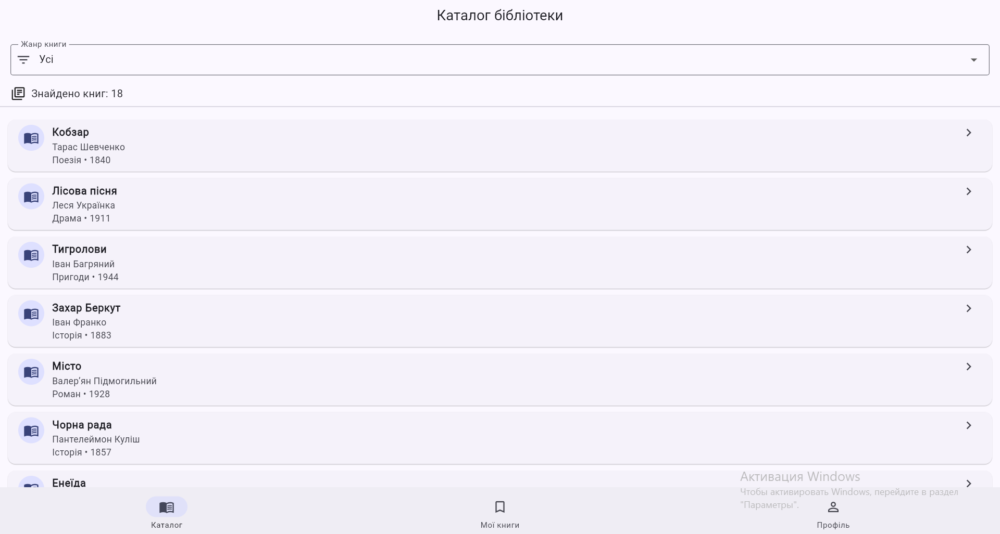
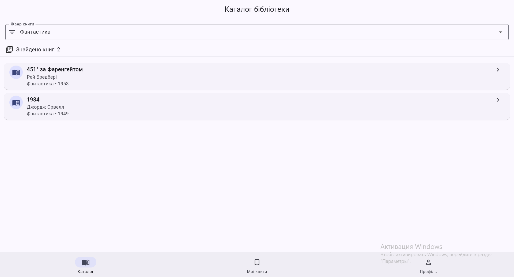
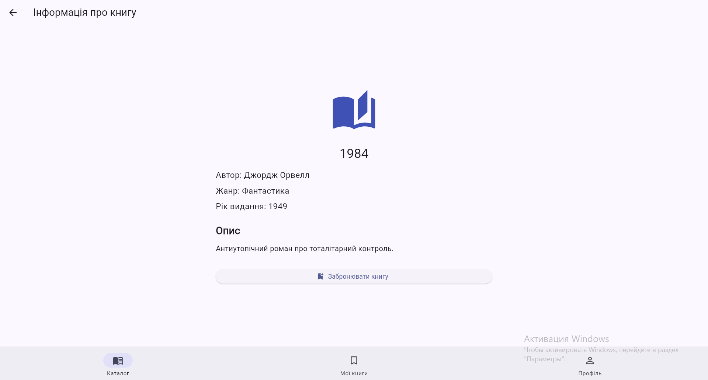
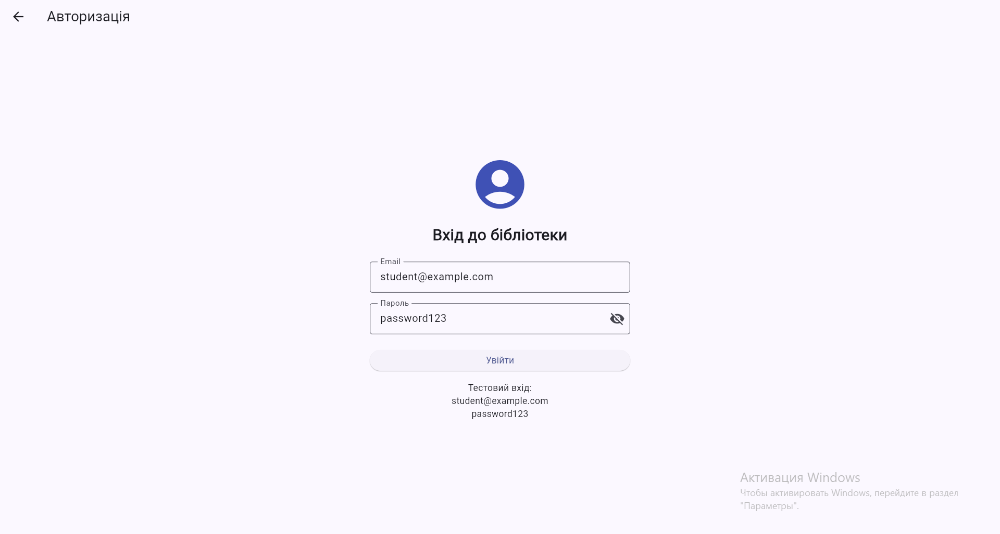
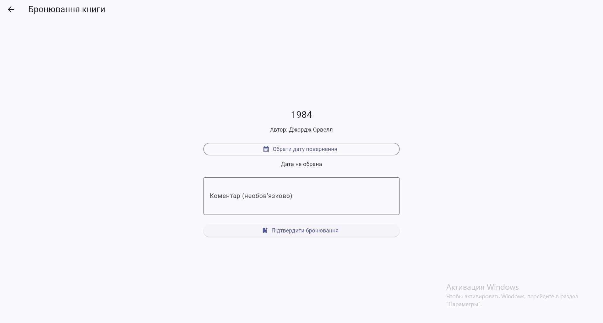
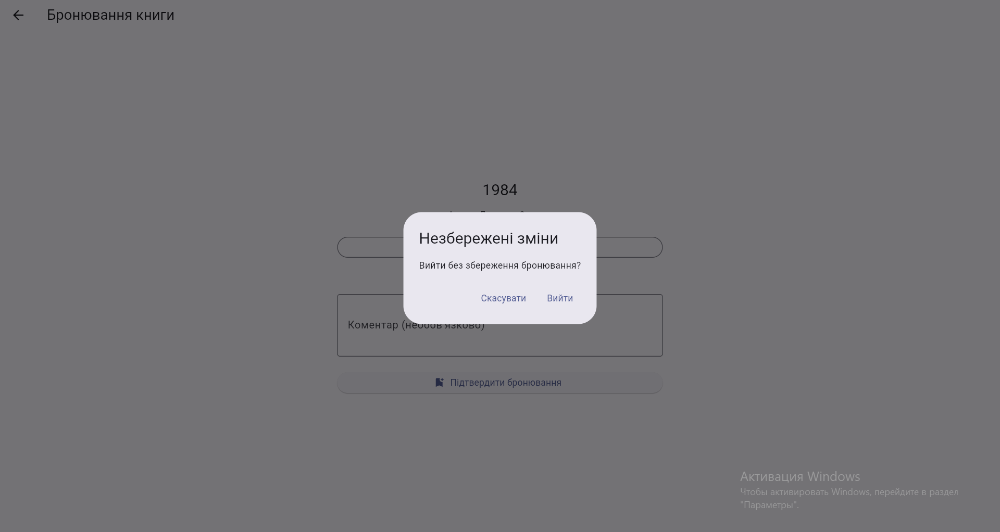
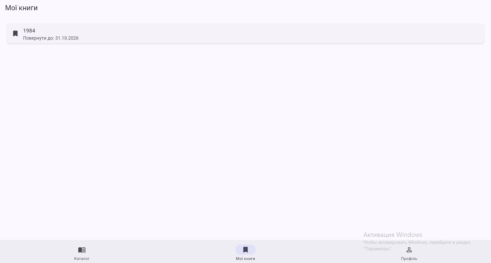
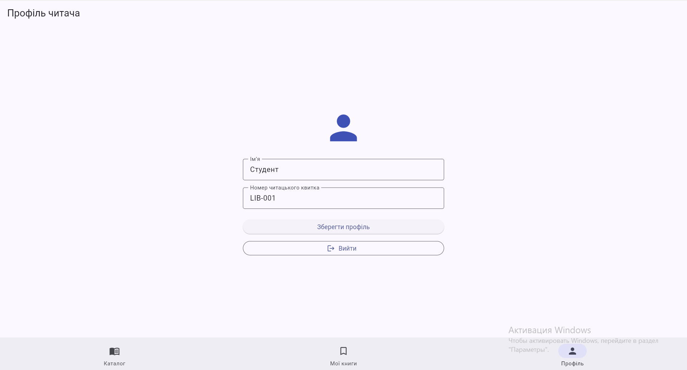

# Бібліотека коледжу

Flutter-застосунок для перегляду каталогу книг, авторизації читачів та бронювання літератури.

Проєкт розроблено в межах практичної роботи №7 з дисципліни «Програмування для мобільних платформ».

**Тема:** Роутинг і навігація у Flutter.

**Варіант №1:** Бібліотека коледжу.

## 1. Мета роботи

Опанувати маршрутизацію та навігацію у Flutter із використанням пакета `go_router`, реалізувати вкладену навігацію, передачу параметрів через URL, захист маршрутів, повернення результатів між екранами та підтримку Deep Links.

## 2. Використані технології

- Flutter 3.47.7
- Dart 3.13.5
- go_router 17.0.0
- Material Design 3
- ChangeNotifier
- Android SDK
- Visual Studio Code

Дані зберігаються в оперативній пам'яті застосунку без використання сервера та бази даних.

## 3. Функціональні можливості

Застосунок забезпечує:

1. Перегляд каталогу з 18 книгами.
2. Фільтрацію книг за жанрами.
3. Перегляд детальної інформації про книгу.
4. Навігацію між вкладками «Каталог», «Мої книги» та «Профіль».
5. Збереження стану вкладок під час перемикання.
6. Авторизацію користувача.
7. Обмеження доступу до бронювання для неавторизованих користувачів.
8. Автоматичне повернення до запитаного маршруту після авторизації.
9. Вибір дати повернення книги.
10. Збереження бронювань у пам'яті застосунку.
11. Редагування імені та номера читацького квитка.
12. Попередження про незбережені зміни.
13. Обробку невідомих маршрутів.
14. Відкриття книг через Deep Links.

## 4. Структура проєкту

```text
lib/
├── main.dart
├── router.dart
├── models/
│   ├── book.dart
│   ├── book_data.dart
│   └── library_model.dart
├── screens/
│   ├── catalog_screen.dart
│   ├── book_screen.dart
│   ├── my_books_screen.dart
│   ├── profile_screen.dart
│   ├── login_screen.dart
│   ├── reserve_screen.dart
│   └── return_date_screen.dart
└── widgets/
    └── main_navigation.dart
```

## 5. Карта маршрутів

| Маршрут | Призначення |
|---|---|
| `/catalog` | Каталог усіх книг |
| `/catalog?genre=Детектив` | Фільтрація за жанром |
| `/catalog/book/:bookId` | Детальна інформація про книгу |
| `/catalog/book/:bookId/reserve` | Бронювання книги (захищений маршрут) |
| `/catalog/book/:bookId/reserve/date` | Вибір дати повернення |
| `/my-books` | Список заброньованих книг |
| `/profile` | Профіль читача |
| `/login` | Авторизація користувача |
| `/login?from=...` | Авторизація з поверненням до запитаного маршруту |

Маршрутизацію реалізовано в `lib/router.dart` за допомогою `GoRouter`.

Для нижньої навігації використовується `StatefulShellRoute.indexedStack`, що забезпечує збереження стану вкладок.

## 6. Авторизація та захист маршрутів

Бронювання книги доступне лише авторизованому користувачу.

Для перевірки авторизації використовуються `redirect` та `refreshListenable`.

Якщо неавторизований користувач відкриває захищений маршрут, його перенаправляють на сторінку входу. Після успішної авторизації застосунок повертає користувача до потрібної сторінки бронювання.

**Тестові дані:**

- Email: `student@example.com`
- Пароль: `password123`

Авторизація є демонстраційною та не використовує сервер.

## 7. Повернення результатів і PopScope

Для вибору дати повернення книги використовується `context.push<DateTime>()`.

Після підтвердження вибрана дата повертається до форми бронювання через `context.pop(date)`.

Для попередження про втрату незбережених змін використовується `PopScope`.

## 8. Запуск застосунку

Встановити залежності:

```powershell
flutter pub get
```

Перевірити код:

```powershell
flutter analyze
```

Запустити у Google Chrome:

```powershell
flutter run -d chrome
```

Переглянути доступні пристрої:

```powershell
flutter devices
```

Запустити на Android-емуляторі:

```powershell
flutter run -d emulator-5554
```

Ідентифікатор Android-пристрою необхідно уточнити через `flutter devices`.

## 9. Deep Links

У застосунку налаштовано власну URL-схему:

```text
library://app/catalog/book/<id>
```

Приклади:

```text
library://app/catalog/book/1
library://app/catalog/book/13
```

Конфігурація Android знаходиться у файлі:

```text
android/app/src/main/AndroidManifest.xml
```

Конфігурація iOS знаходиться у файлі:

```text
ios/Runner/Info.plist
```

### Перевірка на Android

Після встановлення та запуску застосунку виконати:

```powershell
& "H:\DELETE\An\platform-tools\adb.exe" shell am start -a android.intent.action.VIEW -d "library://app/catalog/book/1"
```

Очікуваний результат: відкриття книги «Кобзар».

Для перевірки іншої книги:

```powershell
& "H:\DELETE\An\platform-tools\adb.exe" shell am start -a android.intent.action.VIEW -d "library://app/catalog/book/13"
```

Очікуваний результат: відкриття книги «Гаррі Поттер і філософський камінь».

Після натискання системної кнопки «Назад» користувач повертається до каталогу.

### Перевірка на iOS

На macOS із запущеним iOS Simulator:

```bash
xcrun simctl openurl booted "library://app/catalog/book/1"
```

Конфігурацію iOS додано, однак фактичне тестування на iOS не проводилося через використання Windows.

## 10. Перевірка функціональності

Перевірено такі сценарії:

- Перемикання між трьома вкладками.
- Збереження відкритої книги після переходу до іншої вкладки.
- Фільтрація каталогу за жанром.
- Відкриття книги за ідентифікатором.
- Перенаправлення на авторизацію перед бронюванням.
- Повернення до бронювання після входу.
- Вибір і повернення дати.
- Попередження про незбережені зміни.
- Відображення заброньованих книг.
- Відкриття книги через Android Deep Link.
- Повернення до каталогу кнопкою «Назад».

## 11. Труднощі та їх вирішення

**Відображення URL у браузері.** Під час переходів через `context.push()` адресний рядок браузера спочатку не оновлювався. Проблему вирішено встановленням `GoRouter.optionURLReflectsImperativeAPIs = true`.

**Пошук Android Debug Bridge.** Команда `adb` не розпізнавалася у PowerShell, оскільки шлях до Android SDK не був доданий до `PATH`. Для перевірки використано повний шлях до `adb.exe`.

**Збереження навігації.** Для підтримки окремих стеків вкладок застосовано `StatefulShellRoute.indexedStack`.

**Захист бронювання.** Для автоматичного перенаправлення після зміни стану авторизації застосовано `ChangeNotifier` разом із `refreshListenable`.

## Скріншоти застосунку

### Каталог книг


### Фільтрація за жанром


### Інформація про книгу


### Авторизація


### Бронювання книги


### Попередження про незбережені зміни


### Мої книги


### Профіль читача


## 12. Висновок

У ході практичної роботи розроблено Flutter-застосунок «Бібліотека коледжу» з використанням пакета `go_router`.

Реалізовано вкладену навігацію, передачу path- і query-параметрів, захист маршрутів, повернення результатів між екранами, підтвердження виходу з форми та підтримку Deep Links.

Отримано практичні навички організації маршрутизації у Flutter та керування станом навігації в багатосторінковому застосунку.